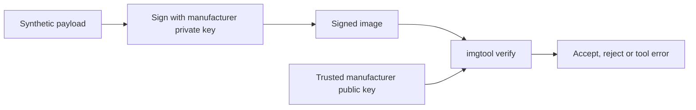

# Firmware Update Verification Lab

This host-side lab uses MCUboot imgtool and Ed25519 keys to show what image verification can establish. It signs a synthetic payload, checks it with a trusted public key and compares five outcomes from one local run.



## Threat model

Assume the verifier starts with an authentic manufacturer public key. The signing key stays with the manufacturer. The lab simulates payload tampering, a replacement signed with a different key and replay of an older trusted release. The hash-only control omits identity verification. A successfully verified old image demonstrates why preventing rollback requires a separate version policy backed by trusted device state. This experiment covers host tooling and synthetic bytes. Device boot, flashing, secure key storage and power-loss recovery are outside its scope.

## Reproduce

Use Python 3.14. Run `python -m venv .venv`, then activate the environment with `.venv\Scripts\Activate.ps1` in PowerShell or `source .venv/bin/activate` on Linux.

```sh
python -m pip install -r requirements.txt
python -m unittest discover -s tests -v
python lab.py demo
```

Each run creates disposable keys, signed images and a detailed verification report under ignored `artifacts/`. The private keys are local test material. The integration test checks the exact one-byte alteration and distinguishes a missing image from a security rejection.

| Scenario | Observed |
| --- | --- |
| Trusted signed image | Accepted |
| One payload byte changed | Rejected |
| Replacement signed by an untrusted key | Rejected |
| Replacement checked without a trusted key | Accepted |
| Older trusted signed image | Accepted |

[Machine-generated result summary](demo/verification-summary.json)
